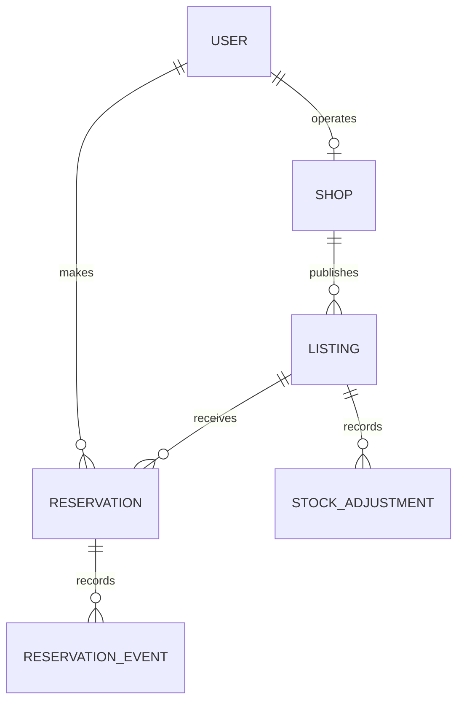

# LastPlate database design

Status: proposed design for review.
Jira task: LP-5.

## 1. Overall structure

Use one PostgreSQL database shared by the whole website.

Django apps:
- accounts: users and shop profiles.
- marketplace: food listings and stock adjustments.
- reservations: reservations and their history.

These are six main project models. Django also creates supporting tables for authentication, permissions, sessions and administration.

Sprint 1 implements users, shops, listings and stock adjustments.
Sprint 2 implements reservations and reservation events.
Sprint 3 completes cancellation flows.

## 2. Main relationships

Each shop has one operator account in this version.
A customer's account does not have a shop profile.
A reservation belongs to one customer and one listing.
Its shop is found through that listing.

## 3. User

Use a custom Django user model configured before the first migration.

| Field | Purpose |
| --- | --- |
| id | Unique account identifier |
| display_name | Name shown to the user |
| email | Login address; unique ignoring letter case |
| password | Password hash managed by Django |
| role | CUSTOMER or SHOP_OPERATOR |
| is_active | Whether the account can authenticate |
| is_staff / is_superuser | Django administration permissions |
| date_joined / last_login | Framework account timestamps |

Public registration cannot grant administrator permissions.
Administrator is a supporting account role, not a separate persona model.
Passwords are never stored as plain text.

## 4. Shop

| Field | Purpose |
| --- | --- |
| id | Unique shop identifier |
| operator | Unique link to its shop-operator User |
| name | Bakery/shop name |
| address | Shop address |
| area | Area used for browsing/filtering |
| public_contact | Contact method intended for customers |
| approval_status | PENDING, APPROVED or REJECTED |
| rejection_reason | Required when rejected |
| reviewed_by / reviewed_at | Administrator and decision time |
| created_at / updated_at | Record timestamps |

New shops start Pending.
Only an administrator can approve or reject.
Publication requires Approved status and a complete profile.

Approval requires complete details and manual confirmation that the applicant represents the shop. Missing confirmation leaves the application Pending. Confirmed false, duplicate or unrelated applications can be rejected with a reason.

Use labelled fictional shops for demonstrations.

## 5. Listing

| Field | Purpose |
| --- | --- |
| id | Unique offer identifier |
| shop | Link to the owning Shop |
| title / description | Food name and contents |
| category | Food category |
| original_price / discounted_price | Decimal USD unit prices |
| total_quantity | Current stock allocated to the offer |
| pickup_address | Address copied from the shop and confirmed |
| pickup_start / pickup_end | Timezone-aware pickup window |
| photo | Optional image storage path |
| ingredients / allergens | Optional shop-supplied information |
| status | DRAFT, PUBLISHED or WITHDRAWN |
| terms_revision | Changes when agreed offer terms change |
| first_reserved_at | Permanent marker locking offer terms |
| created_at / updated_at | Record timestamps |

Publication rules:
- Required food and pickup details must be complete.
- Prices must be positive; discounted price must be lower.
- Publication quantity must be a positive whole number.
- Pickup start must be before pickup end.
- Pickup end must be in the future.
- Photos must be valid JPEG/PNG files, at most 5 MB.
- Missing ingredient/allergen information displays Unknown.

Available quantity is calculated; it is not an independent counter.
Sold-out and pickup-ended conditions are calculated, not additional stored statuses.

After the first reservation, lock contents, prices and pickup terms permanently. Stock adjustments and withdrawal follow their own rules. Stock-only changes do not change terms_revision.

## 6. StockAdjustment

| Field | Purpose |
| --- | --- |
| id | Unique adjustment identifier |
| listing | Affected Listing |
| quantity_change | Positive addition or negative removal |
| reason | Required explanation |
| kind | MANUAL or SHOP_CANCELLATION |
| reservation | Optional link for a shop cancellation |
| actor | User making the adjustment |
| created_at | Time of the change |

Record changes to allocated total stock and save them with the actual stock update in one transaction.

Reservations and collection do not change total_quantity: their effects come from reservation status.

A shop cancellation of unavailable food changes total_quantity and records one linked adjustment. Repeating it must not create another adjustment.

## 7. Reservation

| Field | Purpose |
| --- | --- |
| id | Internal identifier |
| reference | Unique pickup reference |
| customer | Link to the customer User |
| listing | Link to the Listing |
| quantity | Positive whole-number quantity |
| agreed_title | Saved food title |
| agreed_unit_price / agreed_total | Saved decimal USD prices |
| agreed_address | Saved pickup address |
| agreed_pickup_start / agreed_pickup_end | Saved pickup window |
| agreed_terms_revision | Accepted listing revision |
| request_key / request_details | Safe retry key and submitted details |
| status | CONFIRMED, COLLECTED, CANCELLED or EXPIRED |
| created_at | Reservation time |
| collected_at / collected_by | Collection time and operator |

The server calculates the total. The customer cannot submit an authoritative price.

Enforce a unique customer/request_key pair in the database.
Matching retries return the existing reservation, including its current final status. Reusing the key with different details is rejected.

Agreed values are snapshots. Later shop/profile changes do not rewrite them.

## 8. ReservationEvent

| Field | Purpose |
| --- | --- |
| id | Unique event identifier |
| reservation | Affected Reservation |
| from_status / to_status | Transition; creation has no previous status |
| actor | User responsible; empty for a system action |
| reason | Required for shop cancellation |
| created_at | Event timestamp |

Create an event with reservation creation and each successful status change.
Save events in the same transaction as the change.
Repeated actions must not create duplicate transition events.

## 9. Stock calculations

T = total_quantity.
R = quantity in Confirmed reservations.
C = quantity in Collected reservations.

Free stock = T - R - C.
Always keep T >= R + C.

Public reservable stock is zero unless the listing is Published, has free units and has not reached pickup end.

| Action | T | R | C | Free |
| --- | ---: | ---: | ---: | ---: |
| Publish 10 units | 10 | 0 | 0 | 10 |
| Reserve 2 | 10 | 2 | 0 | 8 |
| Collect those 2 | 10 | 0 | 2 | 8 |

Separate cancellation examples starting from T=10, R=2, C=0:
- Customer cancels: T=10, R=0, free=10 if the offer remains open.
- Shop cancels unavailable units: T=8, R=0, free=8.

Collection never deducts stock twice.

## 10. Transactions, permissions and time

Use database constraints for unique references, case-insensitive email uniqueness, request-key uniqueness and valid local field values.

Cross-record stock rules require shared transaction logic. Lock the listing consistently for reservations, stock changes and final transitions; recheck stock, revision, status and server time after locking.

Every protected action checks role and ownership on the server.
A reference alone does not grant access to private reservation details.

- Customer cancellation: strictly before pickup start.
- Collection: pickup start <= now < pickup end.
- Shop cancellation: before pickup end.
- New reservations: before pickup end while the offer is eligible.
- Expiry: remaining Confirmed reservations become Expired within one minute after pickup end.
- Time checks block late actions even if the expiry job is delayed.

Store timezone-aware timestamps and display Asia/Beirut times.
Final states cannot be overwritten by competing actions.

Withdrawal closes availability and resolves active reservations atomically. Preserve collected records and history. Until this flow is implemented in Sprint 3, deny withdrawal with active reservations.

## 11. Retention and implementation checks

Protect referenced shops, listings and users from hard deletion that would erase history. Withdraw offers instead of deleting their reservation records.

Before completing LP-5, review:
- Relationship and field definitions against the specification.
- User-model choice before initial migrations.
- Stock and cancellation examples.
- Saved reservation terms and safe retries.
- Ownership and permanent first-reservation locking.

Implementation tests and migrations are completed in their respective coding tasks. This design document does not claim those tests have passed.

## References

- Django custom-user guidance:
  https://docs.djangoproject.com/en/5.2/topics/auth/customizing/
- Django transaction row-locking guidance:
  https://docs.djangoproject.com/en/6.0/ref/models/querysets/#select-for-update
